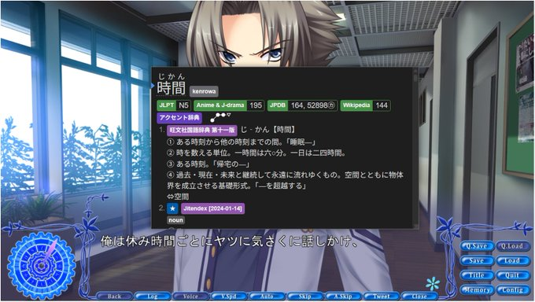

# Rewrite+ Yomitan Overlay

## Screenshot



The companion shows Yomitan’s popup over Rewrite+ using either a fixed test line or live dialogue from LunaTranslator. The test harness renders the fixed line in a regular window. The companion lays out transparent text in an offscreen Yomitan renderer and presents the popup through a click-through Win32 overlay.

```text
「うまいけど、いつか飽きるなこりゃ」
```

## Setup

Use Windows 11, Node.js 22.12 or newer, Git, and the .NET 10 SDK. From the repository root in PowerShell, install the pinned Electron runtime, build the native window tracker, and retrieve the tested Yomitan build from GameSentenceMiner.

```powershell
npm.cmd ci
npm.cmd run build:tracker
git clone --depth 1 --single-branch --filter=blob:none --sparse https://github.com/bpwhelan/GameSentenceMiner.git .local/gsm
git -C .local/gsm sparse-checkout set GSM_Overlay/yomitan
```

The tested GameSentenceMiner revision is `bb62e5b799ce0b02662d3b92964bc6d784916945` and its Yomitan manifest reports `26.10.12.0`. To reproduce that revision if `main` has moved, fetch it in the same local checkout and check it out.

```powershell
git -C .local/gsm fetch --depth 1 origin bb62e5b799ce0b02662d3b92964bc6d784916945
git -C .local/gsm checkout --detach bb62e5b799ce0b02662d3b92964bc6d784916945
```

Open Yomitan’s settings for the companion.

```powershell
npm.cmd start -- --settings
```

Import and enable a Japanese dictionary ZIP under **Dictionaries**. The English JMdict ZIP is suitable for the test. Under **Scanning**, turn off **Select matched text** to keep the original dialogue visually unchanged. Close settings before starting the harness. The companion supplies the Shift gate and saves its own dictionary import under `.local/profile`. [JMdict releases](https://github.com/yomidevs/jmdict-yomitan/releases/latest)

## Run and verify the harness

```powershell
npm.cmd start -- --calibrate
```

1. Bring the **Rewrite+ overlay test harness** to the foreground. The red overlay text and box should line up with the harness dialogue.
2. Hold Shift and move the mouse over the first half of **飽**. Look for Yomitan’s **飽きる【あきる】** entry near the word inside the harness window. Keep holding Shift while moving the pointer from the dialogue into the popup. The popup should stay open.
3. With Shift still held, move over the popup and scroll the mouse wheel to read more of the entry. The game receives wheel input elsewhere and mouse clicks pass through the overlay. Release Shift to close the popup. Click the counter and press Space to check that the harness still receives both kinds of input.
4. Move or resize the window, then minimize and restore it. The red overlay should follow the client area and disappear while the harness is inactive or minimized.
5. Restart without `--calibrate` and repeat the lookup. Only the original harness text and the Yomitan popup should be visible.

Close the harness to end the session. In game mode, use Ctrl+C in the launch terminal or close the game.

## Run over Rewrite+

For live dialogue, keep LunaTranslator in HOOK mode on Rewrite+ and enable its **Network Service**. Choose the dialogue hook in LunaTranslator so its original-text feed follows the text box. Close the harness or static companion, then run:

```powershell
npm.cmd run build:tracker
npm.cmd start -- --live
```

The companion connects to `127.0.0.1:2333`. Use `--luna-port PORT` if LunaTranslator uses a different port. Advance one line after connecting so the companion receives fresh text. Add `--calibrate` to see the guide and get line counts in the terminal. Keep the profile you aligned for Rewrite+ in `calibration.json`.

To verify live mode, advance several lines including one that wraps. Check the red guide against the game and look up a word in each row. With a popup open, advance again and check that the old popup clears. Press Escape or right-click while the game is focused to clear the overlay for menus. The feed supplies text rather than game UI or typewriter state, so wait for the line to finish drawing before looking up a word. A disconnect clears the text and the companion waits for a fresh line after reconnecting. [LunaTranslator network service](https://github.com/HIllya51/LunaTranslator/blob/main/docs/en/apiservice.md)

### Fixed test line and calibration

Use `npm.cmd start -- --game --calibrate` with the exact test line already visible in windowed Rewrite+. The harness is the default because it supplies a reproducible test scene. Game mode attaches the same fixed line to a visible Rewrite+ window owned by `SiglusEngine.exe`. Close the companion before advancing from that line. Use `npm.cmd start -- --game` for the transparent run after alignment.

Create `calibration.json` in the repository root to save overrides. Leave out any values you want to inherit from the defaults. Use `--calibration PATH` to try a second profile. Rename `calibration.json` to restore defaults while retaining your edits.

```json
{
  "x": 160, "y": 526, "height": 140,
  "font": "MS Gothic", "fontSize": 28, "characterAdvance": 28, "lineHeight": 42,
  "fit": "contain", "offsetX": 0, "offsetY": 0, "modifier": "shift"
}
```

- Move `x` and `y` to align the first character. Adjust `characterAdvance` if the gap accumulates across the line. Use `fontSize` and `lineHeight` to match the glyph and row heights. The default wrapping width fits 26 fullwidth cells, with a one-cell indent on continuation rows for dialogue beginning with `「` or `『`. Set `width` to override wrapping and `height` to control clipping. Values use the 1280 × 720 canvas.
- `contain` centers the canvas with letterboxing. `stretch` fills the client. `offsetX` and `offsetY` shift the canvas in native units.
- Set `modifier` to `control` or `alt` if Shift conflicts with the game. The native tracker observes the key and leaves the original keystroke available to the game. Verify the alternative against game bindings too.

## Troubleshooting

- **No popup.** In the companion’s settings, check that Japanese scanning and a Japanese dictionary are enabled. Hold the companion’s configured modifier and rest the cursor over **飽**. Open `--calibrate` to check the targeting region.
- **The wheel goes to the game over the popup.** Hold the configured modifier while scrolling and check that the companion is using the updated tracker (`npm.cmd run build:tracker`). Wheel routing uses the standard popup iframe. If you enabled Yomitan’s advanced popup shadow DOM setting, restore its default of off in the companion’s settings.
- **No overlay.** The target must be foreground and restored. Close any modal dialog over the game. Logs report the tracker’s client size and display scaling.
- **Wrong position.** Check the selected calibration, fit, and offsets. The defaults are a harness baseline. SiglusEngine’s render metrics need real-dialogue calibration.
- **Electron fails in a restricted shell.** Launch from a regular PowerShell session. `REWRITE_ELECTRON` can point to a local official `electron.exe` if you use a portable runtime. Leave Electron’s renderer sandbox and web security enabled.
- **Electron reports unsupported `contextMenus` or first-run `tabs.create`.** Those APIs handle the browser menu and welcome tab. Use `--settings` to open settings directly. The proof of concept tests only the dictionary popup path.

## Decision log

- The stock Edge Yomitan build `26.11.10.0` loaded in Electron but failed in the background worker at `chrome.permissions.getAll`. GameSentenceMiner provides an Electron-compatible Yomitan build. The companion loads that build in an isolated session with the renderer sandbox and web security enabled. The overlay session blocks HTTP and HTTPS. [Electron’s extension support](https://www.electronjs.org/docs/latest/api/extensions) [GameSentenceMiner bundle](https://github.com/bpwhelan/GameSentenceMiner/tree/bb62e5b799ce0b02662d3b92964bc6d784916945/GSM_Overlay/yomitan)
- The physical tests detected Shift and the cursor, and the diagnostic renderer created the right definition. The transparent Electron window failed to present it on the desktop. The companion now sends viewport coordinates to GameSentenceMiner’s Yomitan lookup control and presents Electron’s software-rendered pixels through a non-activating Win32 layered window. [GameSentenceMiner’s lookup control](https://github.com/bpwhelan/GameSentenceMiner/blob/bb62e5b799ce0b02662d3b92964bc6d784916945/GSM_Overlay/yomitan/js/app/frontend.js) [Win32 layered windows](https://learn.microsoft.com/en-us/windows/win32/api/winuser/nf-winuser-updatelayeredwindow)
- The native layer is owned by the Rewrite+ window. This fixed a case where Windows accepted the rendered calibration image but placed it behind the game. [Win32 owned windows](https://learn.microsoft.com/en-us/windows/win32/winmsg/window-features#owned-windows)
- The official Yomitan API requires a native messaging host. Its loopback endpoint did not respond on this machine. It returns dictionary data and the documented routes include no native popup command. Using it here would require adapting the display. [Yomitan API](https://github.com/yomidevs/yomitan-api)
- GameSentenceMiner and YomiNinja demonstrate transparent overlays with Yomitan. Their primary positioning workflows use OCR. The proof of concept reuses the GameSentenceMiner extension build and uses manual calibration for geometry. [GameSentenceMiner overlay](https://github.com/bpwhelan/GameSentenceMiner/wiki/Overlay-%E2%80%90-Overview) [YomiNinja](https://github.com/matt-m-o/YomiNinja)
- The live source subscribes to LunaTranslator’s `/api/ws/text/origin` WebSocket. The companion connects only over loopback and sends no dialogue. LunaTranslator’s built-in network service can also listen on LAN interfaces. For this overlay, keep Rewrite+ as LunaTranslator’s active hook source. The feed carries plain text without per-message game IDs or menu and typewriter metadata. [LunaTranslator network service](https://github.com/HIllya51/LunaTranslator/blob/main/docs/en/apiservice.md)

The GameSentenceMiner bundle, Yomitan, Yomitan API, YomiNinja, and LunaTranslator are GPL-3.0 projects. Electron is MIT. JMdict’s archive is CC BY-SA 4.0. This repo keeps external code and test dictionaries outside version control. [GameSentenceMiner license](https://github.com/bpwhelan/GameSentenceMiner/blob/main/LICENSE) [Yomitan license](https://github.com/yomidevs/yomitan/blob/master/LICENSE) [Electron license](https://github.com/electron/electron/blob/main/LICENSE) [JMdict attribution](https://github.com/yomidevs/jmdict-yomitan)

## Verification

Run `npm.cmd test` for coordinates, calibration, lookup dismissal, and live feed reconnect checks. The Windows 11 test session used 125% display scaling. The tracker measured the game’s displayed client at 1600 × 900 physical pixels while the game reported 96 DPI. The in-game font dialog showed ＭＳ ゴシック and the proportional-font checkbox was unchecked. The red guide was aligned on the fixed test line, and the user confirmed that it followed new dialogue from LunaTranslator in Rewrite+. In the harness, a physical Shift-hover showed the **飽きる【あきる】** popup, the wheel scrolled it, and releasing Shift restored normal wheel input.

The player confirmed that wrapped dialogue worked in the live game and reported no issues across multiple Rewrite+ play sessions with different display setups on November 26–27, 2026.

Dedicated checks for window minimize and restore, game shutdown, and automatic menu detection remain open. CPU/GPU use and popup latency during representative gameplay still need to be measured.
